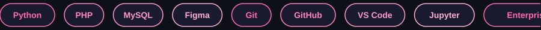

<h1 align="center">Hi there, I'm Amanda 👋</h1>

  

  Building with Python, PHP, IoT, Data Analytics, and Network Security — always learning, always growing 🌱

  

---

### 🚀 What I'm into
-  Data & Machine Learning
-  Web Development (PHP native, Next.js)
-  Network Security
-  UI/UX Design

### 📫 Reach me

  
  

---

  

